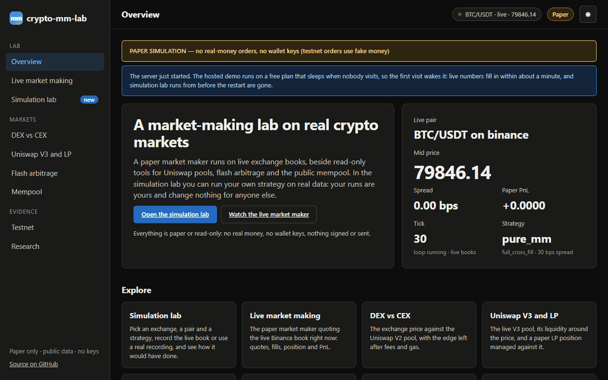
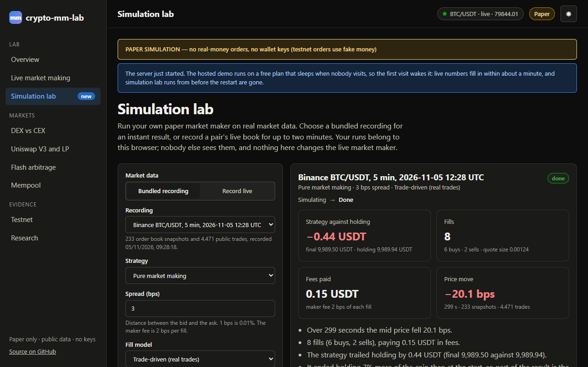
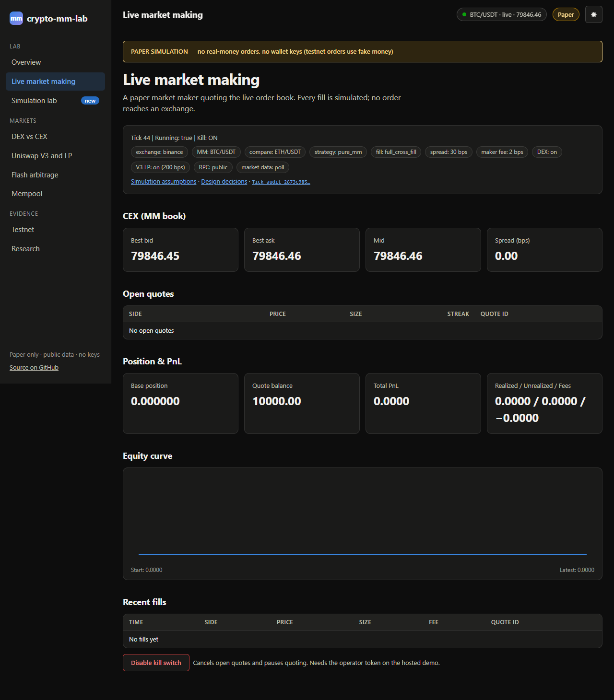
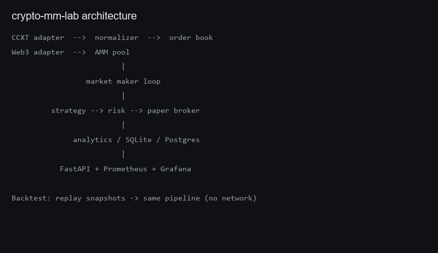
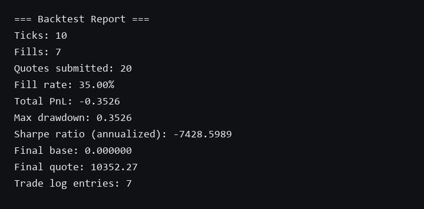
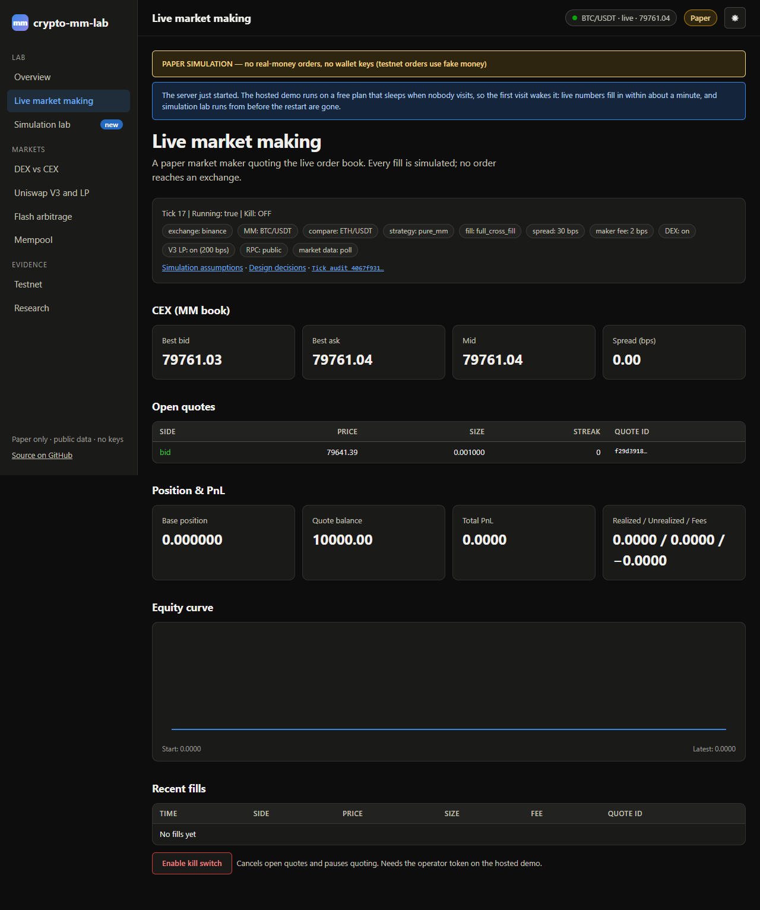
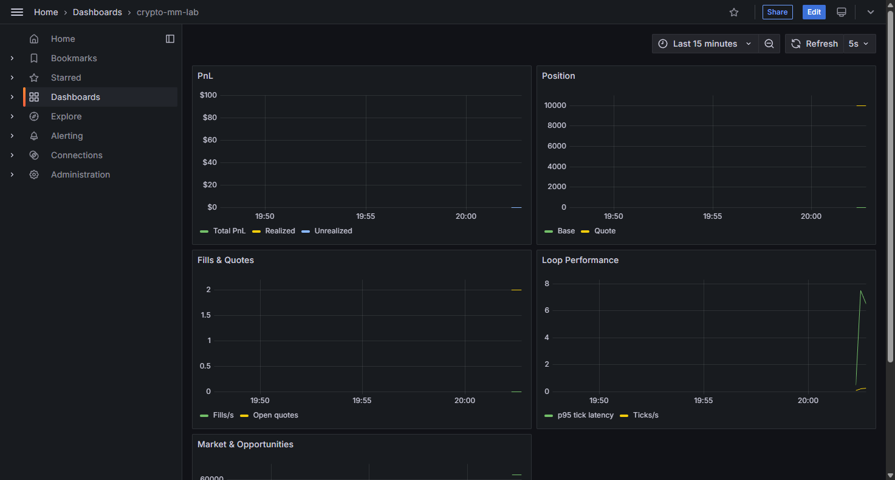

# crypto-mm-lab


[](https://github.com/hudsonferraz/crypto-mm-lab/actions/workflows/ci.yml)
[](https://codecov.io/gh/hudsonferraz/crypto-mm-lab)

**Paper market-making research lab** that pulls live CEX order books, simulates quote placement and fills, tracks PnL, runs a paper **Uniswap V3 concentrated-liquidity** book against the CEX book, compares CEX vs Uniswap V2/V3 prices, and ships with backtest mode plus a Docker observability stack.

This is an **education and research project** — useful for exploring MM mechanics, execution models, and CEX/DEX comparison. It is **not** production trading infrastructure.

**What it does:** end-to-end MM loop on public Binance data plus on-chain Uniswap V3 reads (no API keys, zero cost).  
**How it's built:** FastAPI, CCXT, web3.py + Multicall3, an exact integer port of the Uniswap V3 math, SQLAlchemy, Prometheus/Grafana.  
**Scope and safety:** paper-only, optional operator token for kill switch, conservative fill models — see [Simulation assumptions](#simulation-assumptions), [interview story](docs/interview-story.md), and [design decisions](docs/design-decisions.md).



## Highlights

- **Automated tests + CI** — order book math, fill models (including latency/prob), PnL, AMM, arbitrage scanner, backtest, strategy comparison, research APIs, operator auth, stale-data guards, loop recovery, tick audit
- **Product dashboard** — paper banner, config chips, Live / Opportunities / Research tabs, open quotes, kill confirm, fixture compare + scenario sweep
- **Execution simulation** — cash-account fills (`full_cross_fill`, `partial_fill`, or toy `latency_prob_fill`), auditable quote/fill IDs and per-tick `tick_id` joins
- **Risk and inventory controls** — position caps, cumulative cash reservation, kill switch (optional operator token), stale-tick safeguards
- **Strategy research** — pure MM, inventory skew, volatility-adjusted spread + API/CLI comparison and sweeps
- **Uniswap V3, exact to the wei** — block-pinned pool reads via Multicall3 and a pure-integer port of TickMath / SqrtPriceMath / SwapMath / TickBitmap; simulated swaps match Uniswap's on-chain QuoterV2 with zero difference (47/47 sizes, up to 543 initialized ticks crossed), enforced offline in CI
- **Paper concentrated-liquidity LP book** — ranges around the CEX mid, rebalancing on range exit or drift with cooldown, fees from on-chain fee growth, and a reconciling PnL split: fees, impermanent loss, HODL revaluation, swap cost, gas
- **CEX MM vs on-chain LP** — side-by-side comparison over the same window, on return on capital
- **CEX/DEX analytics** — Uniswap V2 pool reader, V2 + V3 arbitrage scanner (exact V3 output, net-edge-maximizing size), labeled USDT/USDC basis notes
- **Backtesting** — replay from SQLite/Postgres snapshots or CSV fixtures; Sharpe-like ratio, drawdown, fill rate
- **Observability** — Prometheus `/metrics`, Grafana dashboard, structured logging, `last_error` on `/status`
- **Loop resilience** — bounded exponential backoff on tick failures, last-error visibility, automatic shutdown after repeated failures

## Screenshots

| Dashboard (live) | Kill switch |
|------------------|-------------|
|  |  |

| Architecture | Backtest report |
|--------------|-----------------|
|  |  |

| Docker stack (live) | Grafana metrics |
|---------------------|-----------------|
|  |  |

## Capabilities

| Area | What you get |
|------|----------------|
| **Execution simulation** | Paper broker, fill modes, quote lifecycle, cash-account enforcement |
| **Risk and inventory controls** | Position/notional limits, cumulative balance checks, kill switch |
| **Strategy research** | Pluggable strategies + `compare_strategies.py` side-by-side metrics |
| **CEX/DEX analytics** | Live order books, pool reserves, arbitrage opportunity scanning |
| **Backtesting** | Historical replay, performance metrics, strategy comparison |
| **Observability** | Metrics, dashboard, trade blotter, equity curve, structured logs |

### Strategies

| Strategy | Behavior |
|----------|----------|
| `pure_mm` | Fixed symmetric spread around mid |
| `inventory_skew` | Shifts quotes away from inventory imbalance |
| `volatility_spread` | Widens spread using rolling mid-return volatility |

## Quickstart (local)

Requires Python 3.11+.

```bash
cd crypto-mm-lab
python -m pip install -e ".[dev]"
cp .env.example .env
uvicorn app.main:app --reload
```

Open [http://127.0.0.1:8000/dashboard](http://127.0.0.1:8000/dashboard).

### CLI loop

```bash
python scripts/run_mm.py
```

### Backtest

```bash
python scripts/run_backtest.py --fixture tests/fixtures/orderbook_snapshots.csv --strategy pure_mm
python scripts/run_backtest.py --from 2026-01-01 --strategy pure_mm
```

### Strategy comparison

Run all three strategies over the same fixture (or DB window) and print a side-by-side table:

```bash
python scripts/compare_strategies.py --fixture tests/fixtures/orderbook_snapshots.csv
python scripts/compare_strategies.py --fixture tests/fixtures/orderbook_snapshots.csv --json
python scripts/compare_strategies.py --from 2026-01-01 --limit 500
```

## Docker Compose (full stack)

```bash
docker compose up --build
```

| Service | URL |
|---------|-----|
| App + dashboard | [http://localhost:8000/dashboard](http://localhost:8000/dashboard) |
| Prometheus | [http://localhost:9090](http://localhost:9090) |
| Grafana | [http://localhost:3000](http://localhost:3000) (admin/admin) |

## API

| Endpoint | Description |
|----------|-------------|
| `GET /health` | Liveness probe (process is up) |
| `GET /health/live` | Liveness probe (alias) |
| `GET /health/ready` | Readiness probe (503 when loop is enabled but not operational) |
| `GET /metrics` | Prometheus metrics |
| `GET /status` | Loop status, tick count, `last_tick_id`, kill switch, last error |
| `GET /market` | Best bid/ask, mid, spread, `tick_id` |
| `GET /position` | Base/quote inventory with `tick_id` |
| `GET /pnl` | Realized/unrealized PnL and fees with `tick_id` |
| `GET /pnl/history` | PnL time series for equity curve (`?limit=200`) |
| `GET /fills` | Recent trade blotter (`?limit=20`) |
| `GET /report` | Combined status JSON |
| `GET /audit/ticks/{tick_id}` | Full tick audit bundle (order book, quotes, fills, position, PnL, opportunities) |
| `GET /amm` | WETH/USDC pool price vs CEX ETH mid |
| `GET /opportunities` | Latest arbitrage opportunities (V2 + V3, venue, fee tier, optimal size) |
| `GET /v3/pool` | Uniswap V3 pool state, block, data source, liquidity distribution (`?window=false` to skip) |
| `GET /v3/quote` | Exact V3 swap quote (`?side=sell_base\|buy_base&amount=10`) |
| `GET /lp/position` | Paper LP position: range, status, fees, IL, costs, net PnL, reconciliation |
| `GET /lp/history` | LP time series (`?limit=200`) |
| `GET /lp/rebalances` | Recent LP opens/rebalances with costs (`?limit=20`) |
| `GET /research/books` | CEX book vs LP book (live since start, or `?from=&to=` persisted window) |
| `GET /research/lp-backtest` | LP sweep over recorded mainnet observations (`?widths_bps=20,50&thresholds_bps=10`) |
| `POST /kill-switch` | Enable/disable kill switch (`{"active": true}`) |
| `GET /dashboard` | Static monitoring UI |

## Uniswap V3 concentrated liquidity

The V3 layer is additive (V2 is unchanged) and costs nothing to run.

- **Reads**: one `Multicall3.tryBlockAndAggregate` `eth_call` per loop on the keyless public RPC (`ETH_RPC_URL`). The tick window (bitmap words ± `V3_WINDOW_WORDS`) is reloaded every `V3_WINDOW_REFRESH_TICKS` loops, pinned to the same block.
- **Exactness**: `python scripts/verify_v3_quotes.py` compares the simulator with QuoterV2 at one block (`--record` refreshes `tests/fixtures/v3_quote_vectors.json`, which CI replays offline). Example run, block 26,329,444: `compared 47, mismatches 0`.
- **LP book**: separate capital (`LP_CAPITAL_QUOTE`). Opening swaps into the required token ratio through the exact simulator, then mints with protocol liquidity math (mint rounds up, burn rounds down). The kill switch freezes it.
- **Backtest**: `python scripts/run_lp_backtest.py --fixture tests/fixtures/v3_pool_observations.csv --widths 20,50,200 --thresholds 10,40`, over real per-block mainnet observations recorded with `scripts/record_v3_fixture.py`.
- **Optional history**: `scripts/backfill_v3.py` needs an archive-capable URL (a free tier works) in `ETH_ARCHIVE_RPC_URL`. The public node serves only about 128 blocks, and the script says so.
- **Keyless hosted demo**: if live V3 reads never succeed and `FIXTURE_FALLBACK_ENABLED=true`, the loop replays recorded mainnet observations, labeled `data_source: fixture`.

## Architecture

See [docs/architecture.md](docs/architecture.md) for the full diagram and data flow.

## Simulation assumptions

This project is a **paper-trading lab**, not a production market-making system. Results are useful for learning and comparison, but they are **not** predictive of live performance. Key simplifications:

### Execution

- **No live orders** — quotes and fills are simulated locally. CEX access is read-only (public order books via CCXT). DEX access is read-only (`getReserves()` over RPC).
- **Cash account only** — you cannot sell base you do not own or bid beyond available quote balance (including fees). Risk filters reserve aggregate exposure across multiple quotes on the same tick. No margin, leverage, or short selling.
- **Fill model** (`FILL_MODE`):
  - `full_cross_fill` (default) — if the external best bid/ask crosses your resting quote, the full quote size fills at your price.
  - `partial_fill` — same trigger, but fill size is capped by opposing top-of-book depth.
  - Neither mode models queue position, order-flow priority, or latency.
- **Quote lifecycle** — resting quotes are replaced each tick; partial remainders persist only until the next submission. Each quote receives a UUID at submission; fills carry the same ID for audit joins. Every persisted tick receives a shared `tick_id` so operators can reconstruct the full state via `GET /audit/ticks/{tick_id}`.

### Market data

- **Polling by default; optional websocket** — order books refresh on a fixed interval (default 2s). `MARKET_DATA_MODE=websocket` uses `watch_order_book` when available and falls back to REST with an explicit status note.
- **Top-of-book focus** — strategies quote from mid price; stored snapshots keep best bid/ask only. Backtests reconstruct a minimal two-level book from those prices.
- **Stale fallback** — if a CEX fetch fails, the adapter may reuse the last cached book (flagged `is_stale`). Stale ticks cancel resting quotes, skip fills and new quoting, increment `mm_stale_ticks_total`, and suppress DEX arbitrage opportunities when either the primary or compare CEX snapshot is stale. Stale books remain observable in storage and on the dashboard, but they are never executable.

### PnL and fees

- **Average-cost accounting** — realized PnL uses average entry price for deterministic inventory state. There is no lot-level attribution.
- **Configurable fees** — maker/taker fees are flat basis-point rates (`MAKER_FEE_BPS`, `TAKER_FEE_BPS`). DEX arbitrage estimates include AMM fee, gas, and slippage attribution fields; AMM fee and price impact are already embedded in swap output and are not deducted twice from net edge.
- **Unrealized PnL** — mark-to-market on base inventory using current mid.

### DEX comparison

- **Uniswap V2 and V3** — constant-product math for the V2 pair; exact V3 math (verified against QuoterV2) for the WETH/USDC 5 bps pool, both vs CEX ETH/USDT mid.
- **Arbitrage is observational** — opportunities are scanned and logged; no on-chain execution. The dashboard labels MM vs compare symbols and the USDT/USDC basis risk.

### Uniswap V3 LP book

- **Small-position assumption** — the paper position neither dilutes pool fee growth nor moves the pool price.
- **Fee accounting** — `exact` (protocol `feeGrowthInside` from on-chain bound ticks) when both range bounds are initialized ticks, otherwise `approximate` (global fee growth weighted by in-range status). Each interval is labeled. Backtests are approximate.
- **Range centering** — on the CEX compare mid, falling back to the pool price when a CEX-centered range would not contain the pool price (USDT/USDC basis).
- **Costs** — setup and rebalance swaps go through the exact simulator (fee + price impact). Gas = `LP_REBALANCE_GAS_UNITS` × (block basefee + `LP_PRIORITY_FEE_GWEI`), valued at the pool price.
- **Reconciliation** — `value − capital = fees + IL + HODL − swap cost − gas` on every observation; the residual is exposed and tested to stay under 0.01% of capital.

### Backtest metrics

- **Sharpe-like ratio** — computed from per-tick PnL *changes* (not portfolio returns), annualized using the average interval between snapshot timestamps. This is a useful lab statistic for comparing replay runs, but it is not a textbook portfolio Sharpe ratio. Drawdown and fill rate are reported alongside it.

### Security and ops

- **Local DX is open; hosted demos should set `OPERATOR_API_TOKEN`** — when set, `POST /kill-switch` requires `X-Operator-Token`. Read endpoints stay public for portfolio demos. See [docs/deploy-demo.md](docs/deploy-demo.md).
- **No wallet keys** — by design; nothing signs transactions.
- **Loop failure handling** — tick errors are retried with bounded exponential backoff; `/status` exposes `last_error`. After repeated consecutive failures the loop stops rather than reporting a false healthy state.

See [docs/deploy-demo.md](docs/deploy-demo.md) and the root [`render.yaml`](render.yaml) Blueprint for a one-click Render paper demo.

## Configuration

See `.env.example`. Key variables:

| Variable | Description |
|----------|-------------|
| `EXCHANGE`, `SYMBOL` | CEX data source (default `binance`, `BTC/USDT`) |
| `DB_URL` / `DATABASE_URL` | SQLite (local) or PostgreSQL (Docker) |
| `STRATEGY` | `pure_mm`, `inventory_skew`, or `volatility_spread` |
| `FILL_MODE` | `full_cross_fill`, `partial_fill`, or `latency_prob_fill` |
| `MARKET_DATA_MODE` | `poll` (default) or `websocket` (falls back to poll if unsupported) |
| `OPERATOR_API_TOKEN` | Optional; protects kill switch when set |
| `DEX_ENABLED` | Enable on-chain pool reader + arbitrage scanner |
| `METRICS_ENABLED` | Export Prometheus metrics from the loop |
| `V3_ENABLED`, `V3_POOL_ADDRESS` | Uniswap V3 reader (default WETH/USDC 5 bps pool) |
| `V3_WINDOW_WORDS`, `V3_WINDOW_REFRESH_TICKS` | Tick-window size and refresh cadence |
| `LP_ENABLED`, `LP_CAPITAL_QUOTE` | Paper LP book and its separate capital |
| `LP_RANGE_WIDTH_BPS`, `LP_REBALANCE_THRESHOLD_BPS`, `LP_REBALANCE_COOLDOWN_SEC` | Range and rebalance rules |
| `ETH_ARCHIVE_RPC_URL` | Optional archive URL for `scripts/backfill_v3.py` only (secret) |

## Development

```bash
ruff check .
pytest -v --cov=app --cov-report=term-missing
pytest --live tests/test_v3_live.py   # optional: live QuoterV2 parity on the public RPC
```

Coverage is measured on `app/` with **branch coverage** enabled. CI fails under **85%** (suite currently ~**89%** branch / ~**92%** line).

Regenerate portfolio screenshots and demo GIF (requires a running app for live dashboard captures):

```bash
python scripts/build_portfolio_assets.py
```

## Design decisions

Extended write-up of architecture and simulation choices: [docs/design-decisions.md](docs/design-decisions.md).

## License

See [LICENSE](LICENSE).
