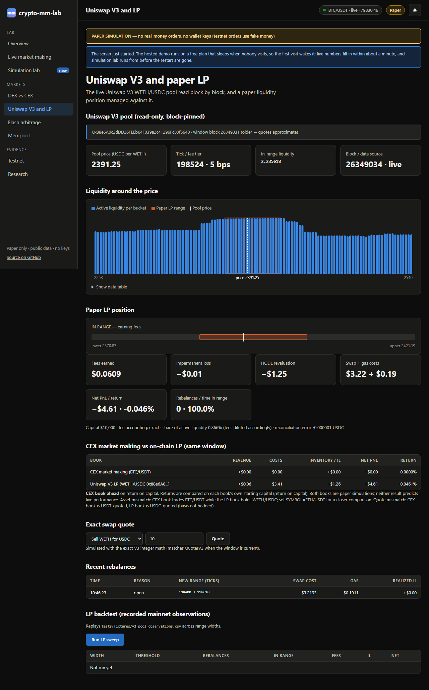
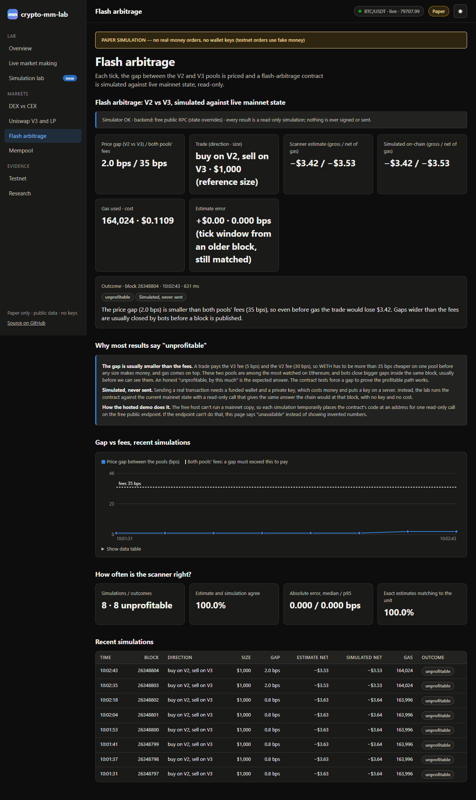
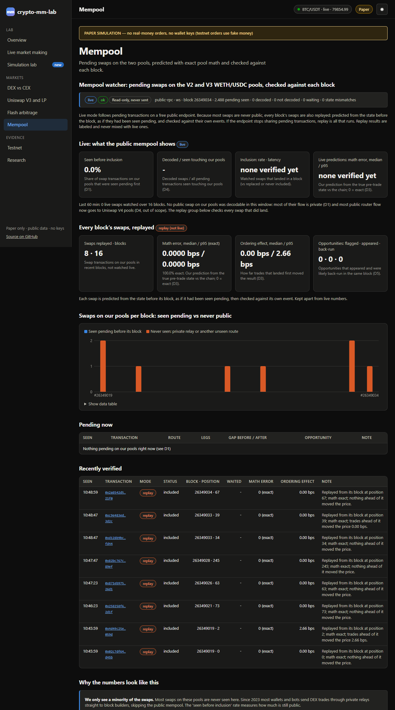
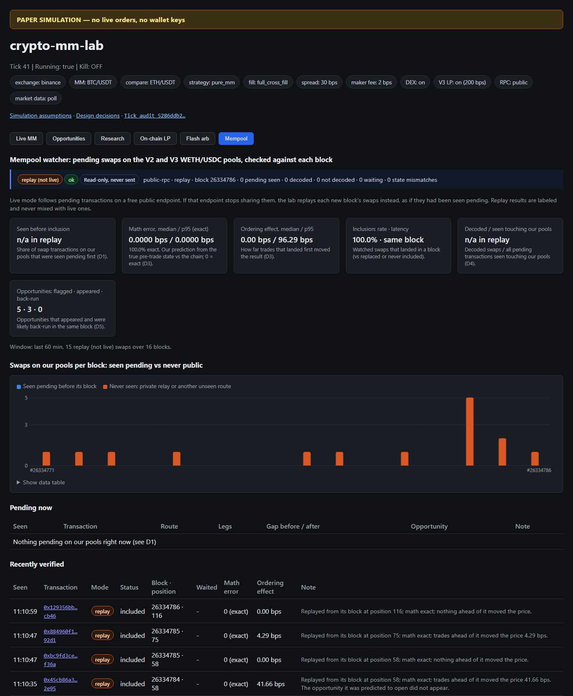
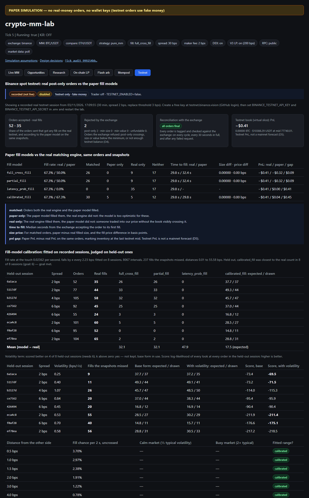

# crypto-mm-lab


[](https://github.com/hudsonferraz/crypto-mm-lab/actions/workflows/ci.yml)
[](https://codecov.io/gh/hudsonferraz/crypto-mm-lab)

**A paper market-making research lab for crypto.** It quotes on live Binance order books, runs a paper Uniswap V3 liquidity position, simulates a Solidity flash-arbitrage contract against live mainnet state, watches the public mempool, and checks its paper fill models against real orders on the Binance testnet. Everything runs on free public data, with no API keys, no wallet and no real money.

This is an **education and research project**, not production trading infrastructure.

## What this shows

| Area | Result | Evidence |
|---|---|---|
| Exact DeFi math | A pure-integer port of Uniswap V3's swap math matches the on-chain QuoterV2 to the wei (47 of 47 sizes, up to 543 ticks crossed), checked offline in CI | [Uniswap V3](#uniswap-v3-concentrated-liquidity) |
| Smart contracts | An owner-only flash-arbitrage contract with unit, fuzz and invariant tests, 100% branch coverage and a gas gate. Every tick it is simulated against live mainnet state, and the scanner's estimate matches to the unit | [Flash-arbitrage executor](#flash-arbitrage-executor-solidity) |
| Mempool | Pending swaps on the two pools are decoded and their price impact predicted, then checked against the block they land in. Every replayed swap is reproduced with zero math error | [Mempool watcher](#mempool-watcher) |
| Execution realism | Real post-only orders on the Binance testnet show the paper fill models are too pessimistic (50% vs 67% fill rate). A fill model fitted on 8 recorded sessions is the closest to real fills in 8 of 8 sessions it was not fitted on. A volatility term was tested against a rule fixed in advance, failed, and was reported as failed | [Testnet execution](#binance-spot-testnet-execution) |
| Market making | Pure, inventory-skew and volatility-adjusted strategies, with position caps, a kill switch, backtests and strategy sweeps | [Capabilities](#capabilities) |
| Engineering | FastAPI, web3.py with Multicall3, Solidity 0.8.28 with Foundry, SQLAlchemy, Prometheus and Grafana; 570+ tests in CI; every design choice written down with its trade-off | [Design decisions](docs/design-decisions.md) |

Start with the [Quickstart](#quickstart-local): four commands run the whole lab locally, without keys. See also the [simulation assumptions](#simulation-assumptions) and the [interview story](docs/interview-story.md).


## Highlights

- **Product dashboard** — paper-trading banner, config chips, seven tabs (Live MM, Opportunities, Research, On-chain LP, Flash arb, Mempool, Testnet), each result explained in plain language
- **Execution simulation** — cash-account fills (`full_cross_fill`, `partial_fill`, toy `latency_prob_fill`, or `calibrated_fill` fitted on real testnet sessions), auditable quote and fill IDs, per-tick `tick_id` joins
- **Risk and inventory controls** — position caps, cumulative cash reservation, kill switch (optional operator token), stale-tick safeguards
- **Strategy research** — pure MM, inventory skew, volatility-adjusted spread, with API/CLI comparison and sweeps
- **Uniswap V3, exact to the wei** — block-pinned pool reads via Multicall3 and a pure-integer port of TickMath, SqrtPriceMath, SwapMath and TickBitmap
- **Paper concentrated-liquidity LP book** — ranges around the CEX mid, rebalancing with cooldown, fees from on-chain fee growth, and a PnL split that reconciles: fees, impermanent loss, HODL revaluation, swap cost, gas. Compared side by side with CEX market making on return on capital
- **Solidity flash-arbitrage executor** — captures a V2/V3 price gap in one transaction through a Uniswap V3 flash swap, tested against the real Uniswap V2 and V3 core contracts, with an opt-in mainnet-fork suite whose profit matches QuoterV2 exactly
- **Mempool watcher** — a free keyless websocket; decodes direct pool calls, the V2 router, the V3 swap routers and the Universal Router. Pool state rolled forward from events matched a fresh chain read after 60 blocks with zero drift
- **Binance spot testnet execution** — with a free key: real post-only orders (fake money, host fixed in code), reconciled with the exchange, compared with every paper fill model on identical snapshots. Eight recorded sessions ship for the keyless demo
- **CEX/DEX analytics** — Uniswap V2 pool reader, V2 + V3 arbitrage scanner (exact V3 output, net-edge-maximizing size), labeled USDT/USDC basis notes
- **Backtesting** — replay from SQLite/Postgres snapshots or CSV fixtures; Sharpe-like ratio, drawdown, fill rate
- **Observability and resilience** — Prometheus `/metrics`, Grafana dashboard, structured logging, `last_error` on `/status`, bounded backoff on tick failures and shutdown after repeated failures

## Screenshots

| Dashboard (live) | Kill switch |
|------------------|-------------|
|  |  |

| Architecture | Backtest report |
|--------------|-----------------|
|  |  |

| On-chain LP (Uniswap V3, live mainnet data) |
|---------------------------------------------|
|  |

| Flash arb (contract simulated against live mainnet state) |
|------------------------------------------------------------|
|  |

| Mempool watcher, live: public visibility, plus every swap replayed alongside | Mempool watcher, forced block replay |
|------------------------------------------------------|------------------------------------------------------|
|  |  |

| Testnet: real post-only orders vs the paper fill models, and the fill-model calibration judged on held-out sessions (recorded, keyless demo) |
|------------------------------------------------------------------------------------------|
|  |

| Docker stack (live) | Grafana metrics |
|---------------------|-----------------|
|  |  |

## Capabilities

| Area | What you get |
|------|----------------|
| **Execution simulation** | Paper broker, fill modes, quote lifecycle, cash-account enforcement |
| **Risk and inventory controls** | Position/notional limits, cumulative balance checks, kill switch |
| **Strategy research** | Pluggable strategies + `compare_strategies.py` side-by-side metrics |
| **CEX/DEX analytics** | Live order books, pool reserves, arbitrage opportunity scanning |
| **Backtesting** | Historical replay, performance metrics, strategy comparison |
| **Observability** | Metrics, dashboard, trade blotter, equity curve, structured logs |

### Strategies

| Strategy | Behavior |
|----------|----------|
| `pure_mm` | Fixed symmetric spread around mid |
| `inventory_skew` | Shifts quotes away from inventory imbalance |
| `volatility_spread` | Widens spread using rolling mid-return volatility |

## Quickstart (local)

Requires Python 3.11+.

```bash
cd crypto-mm-lab
python -m pip install -e ".[dev]"
cp .env.example .env
uvicorn app.main:app --reload
```

Open [http://127.0.0.1:8000/dashboard](http://127.0.0.1:8000/dashboard).

### CLI loop

```bash
python scripts/run_mm.py
```

### Backtest

```bash
python scripts/run_backtest.py --fixture tests/fixtures/orderbook_snapshots.csv --strategy pure_mm
python scripts/run_backtest.py --from 2026-01-01 --strategy pure_mm
```

### Strategy comparison

Run all three strategies over the same fixture (or DB window) and print a side-by-side table:

```bash
python scripts/compare_strategies.py --fixture tests/fixtures/orderbook_snapshots.csv
python scripts/compare_strategies.py --fixture tests/fixtures/orderbook_snapshots.csv --json
python scripts/compare_strategies.py --from 2026-01-01 --limit 500
```

## Docker Compose (full stack)

```bash
docker compose up --build
```

| Service | URL |
|---------|-----|
| App + dashboard | [http://localhost:8000/dashboard](http://localhost:8000/dashboard) |
| Prometheus | [http://localhost:9090](http://localhost:9090) |
| Grafana | [http://localhost:3000](http://localhost:3000) (admin/admin) |

## API

| Endpoint | Description |
|----------|-------------|
| `GET /health` | Liveness probe (process is up) |
| `GET /health/live` | Liveness probe (alias) |
| `GET /health/ready` | Readiness probe (503 when loop is enabled but not operational) |
| `GET /metrics` | Prometheus metrics |
| `GET /status` | Loop status, tick count, `last_tick_id`, kill switch, last error |
| `GET /market` | Best bid/ask, mid, spread, `tick_id` |
| `GET /position` | Base/quote inventory with `tick_id` |
| `GET /pnl` | Realized/unrealized PnL and fees with `tick_id` |
| `GET /pnl/history` | PnL time series for equity curve (`?limit=200`) |
| `GET /fills` | Recent trade blotter (`?limit=20`) |
| `GET /report` | Combined status JSON |
| `GET /audit/ticks/{tick_id}` | Full tick audit bundle (order book, quotes, fills, position, PnL, opportunities) |
| `GET /amm` | WETH/USDC pool price vs CEX ETH mid |
| `GET /opportunities` | Latest arbitrage opportunities (V2 + V3, venue, fee tier, optimal size) |
| `GET /v3/pool` | Uniswap V3 pool state, block, data source, liquidity distribution (`?window=false` to skip) |
| `GET /v3/quote` | Exact V3 swap quote (`?side=sell_base\|buy_base&amount=10`) |
| `GET /lp/position` | Paper LP position: range, status, fees, IL, costs, net PnL, reconciliation |
| `GET /lp/history` | LP time series (`?limit=200`) |
| `GET /lp/rebalances` | Recent LP opens/rebalances with costs (`?limit=20`) |
| `GET /research/books` | CEX book vs LP book (live since start, or `?from=&to=` persisted window) |
| `GET /research/lp-backtest` | LP sweep over recorded mainnet observations (`?widths_bps=20,50&thresholds_bps=10`) |
| `GET /arb/simulation` | Simulator status and the latest flash-arb simulation, with its plain-language explanation |
| `GET /arb/simulations` | Recent simulations (`?limit=100`) |
| `GET /arb/accuracy` | How often the scanner's estimate agrees with the simulation, and its error |
| `GET /mempool/status` | Watcher mode (live / replay), state, backend label, counters, mode changes, and the D1–D7 explanations |
| `GET /mempool/swaps` | Watched swaps with prediction, verification and a plain-language note (`?limit=50&mode=live&status=included`) |
| `GET /mempool/swaps/{tx_hash}` | One watched swap |
| `GET /mempool/blocks` | Per-block swaps on our pools and how many were seen pending (`?limit=50&mode=live`) |
| `GET /mempool/summary` | Accuracy, inclusion latency, visibility, decode coverage and capture rate, live and replay kept separate (`?window_minutes=60`) |
| `GET /testnet/status` | Testnet trader state, keys present (yes/no only), session, counters, reconciliation, the D1–D7 explanations, and the recorded session's details |
| `GET /testnet/orders` | Testnet orders with life cycle and what each paper fill model filled (`?state=open\|final\|all&limit=50`) |
| `GET /testnet/fills` | Real testnet fills (`?limit=50`) |
| `GET /testnet/balances` | Virtual testnet slice, PnL at the testnet mid, and the account totals |
| `GET /testnet/comparison` | Per fill model: fill rate real vs paper, matched / paper only / real only / neither, time to fill, PnL gap (`?window_minutes=60`) |
| `GET /testnet/sessions` | Testnet sessions and why they ended |
| `GET /testnet/calibration` | The fitted `calibrated_fill` parameters and the form in use, their source sessions, the leave-one-session-out results for both forms and the gate, the fill-chance curve (with calm and busy columns when the volatility form is in use) and the explanations |
| `POST /kill-switch` | Enable/disable kill switch (`{"active": true}`) |
| `GET /dashboard` | Static monitoring UI |

## Uniswap V3 concentrated liquidity

The V3 layer is additive (V2 is unchanged) and costs nothing to run.

- **Reads**: one `Multicall3.tryBlockAndAggregate` `eth_call` per loop on the keyless public RPC (`ETH_RPC_URL`). The tick window (bitmap words ± `V3_WINDOW_WORDS`) is reloaded every `V3_WINDOW_REFRESH_TICKS` loops, pinned to the same block.
- **Exactness**: `python scripts/verify_v3_quotes.py` compares the simulator with QuoterV2 at one block (`--record` refreshes `tests/fixtures/v3_quote_vectors.json`, which CI replays offline). Example run, block 26,329,444: `compared 47, mismatches 0`.
- **LP book**: separate capital (`LP_CAPITAL_QUOTE`). Opening swaps into the required token ratio through the exact simulator, then mints with protocol liquidity math (mint rounds up, burn rounds down). The kill switch freezes it.
- **Backtest**: `python scripts/run_lp_backtest.py --fixture tests/fixtures/v3_pool_observations.csv --widths 20,50,200 --thresholds 10,40`, over real per-block mainnet observations recorded with `scripts/record_v3_fixture.py`.
- **Optional history**: `scripts/backfill_v3.py` needs an archive-capable URL (a free tier works) in `ETH_ARCHIVE_RPC_URL`. The public node serves only about 128 blocks, and the script says so.
- **Keyless hosted demo**: if live V3 reads never succeed and `FIXTURE_FALLBACK_ENABLED=true`, the loop replays recorded mainnet observations, labeled `data_source: fixture`.

## Flash-arbitrage executor (Solidity)

`contracts/` is a Foundry project with one contract, [`FlashArbExecutor`](contracts/src/FlashArbExecutor.sol). It captures a WETH price gap between the Uniswap V3 5 bps pool and the Uniswap V2 pair in a single transaction, with no starting capital. Every trade starts as a V3 **flash swap**: the pool sends its output first and collects payment in a callback, where the V2 leg runs. If the trade cannot pay, the whole transaction is undone.

- **V3→V2**: pay USDC to V3 for WETH, then sell that WETH on V2 for more USDC.
- **V2→V3**: sell WETH to V3 for USDC, then buy that WETH back on V2 for less, delivered straight to the V3 pool.

**Defenses**: pools and tokens are fixed at deployment; only the owner can trade (two-step ownership handover); the callback only accepts the fixed V3 pool while a trade is in progress, using a transient-storage guard that also blocks reentrancy; profit is decided from computed amounts before anything is paid, so stray tokens are never spent covering a loss; profit leaves the contract in the same transaction, so it never holds funds a bug could lose.

**Tests** run against the real Uniswap V2 and V3 core contracts (git submodules), offline:

| Suite | What it proves |
|---|---|
| Unit (50, both token orders) | both directions, profit rule, every revert reason, access control, fake-pool and reentrancy attacks, ownership, recovery, storage layout |
| Fuzz (1,000 runs per property) | over random gaps and sizes: `execute` either pays exactly the simulated profit to the owner or reverts; the executor never keeps tokens; no pool is underpaid |
| Invariant (256 runs x 50 calls) | random calls from random actors while the market moves: balances only reflect donations, no unauthorized call ever succeeds, ownership only changes through the handover |
| Mainnet fork (opt-in) | against the real deployed pools, an induced gap is captured in both directions and the profit equals QuoterV2 plus the V2 formula exactly |

Branch coverage of the executor is 100% (CI floor 90%). Gas baselines, gated at +2% in CI:

| Path (optimal size for a ~4% induced gap) | Gas |
|---|---|
| `execute` V3→V2 | 175,995 |
| `execute` V2→V3 | 168,321 |

On mainnet forks, the same paths cost 220k–250k gas, because storage is cold and real trades cross more ticks.

```bash
cd contracts
forge test                                    # offline: unit, fuzz, invariant
FOUNDRY_PROFILE=fork FORK_RPC_URL=https://ethereum.publicnode.com forge test -vv
sh ../scripts/forge_coverage.sh               # coverage gate
```

Clone with `--recurse-submodules` (or run `git submodule update --init --recursive`). Foundry is free: `curl -L https://foundry.paradigm.xyz | bash && foundryup`. On Windows, use the `foundry_stable_win32_amd64.zip` release.

### Scanner vs contract, every tick

Each tick, the lab:

1. Reads the V2 reserves at the same block as the V3 snapshot.
2. Finds the most profitable V2-vs-V3 trade with exact integer math. When no size is profitable, it uses a fixed reference size, so every tick still has a comparable result.
3. Runs the executor's `simulate()` entry point against mainnet state at that block.

The scanner's estimate and the contract's result agree to the unit when the V3 tick window is current. The **Flash arb** dashboard tab shows both side by side, with gas, net profit and a plain-language explanation of the outcome.

### Why it's built this way

- **Most live results say "unprofitable", and that's the correct answer.** A trade pays both pools' fees (5 + 30 bps), so WETH must be more than 35 bps cheaper on one pool before any size pays, and gas comes on top. Professional bots close larger gaps between these two heavily watched pools within the same block. Showing "unprofitable, by this much" and measuring the scanner's accuracy is more credible than showing profits that would never happen. The tests force a gap to prove the profitable path works.
- **Simulate, never send.** Sending a real transaction needs a funded wallet and a private key on a server, which costs gas, creates a security risk, and breaks this project's zero-cost, no-keys rules. A simulation against real state at a given block gives the same answer the chain would, without either.
- **A simulation mode that always reverts.** A failed trade normally just says "failed", which tells us nothing on most ticks. `simulate()` runs both legs, then reverts with the amounts inside the error. Uniswap's own quoter contract uses the same pattern, and a revert can never change state. To let an unprofitable trade finish so it can be measured, the simulation temporarily gives the executor a USDC balance.
- **No local node on the hosted demo.** The free host can't run a mainnet copy, and deploying for real costs gas and needs a key. Instead, each simulation is one `eth_call` to the free public endpoint that temporarily places the contract's code at an address (a "state override"). If the endpoint ever stops supporting that, the dashboard says "unavailable" instead of inventing numbers. To use a local fork instead, run `anvil --fork-url https://ethereum.publicnode.com --chain-id 31337` and set `ETH_RPC_URL=http://127.0.0.1:8545`; the simulation follows it. Expect the first V3 tick-window load on a cold fork to take minutes, because anvil fetches each storage slot through the public endpoint.
- **Tests use a recent block.** The free endpoint keeps only about the last 128 blocks (around 25 minutes), and pinning an old block needs a paid or keyed archive endpoint. The fork tests check properties that hold at any block. Set `FORK_BLOCK` with an archive endpoint to pin one.
- **Fixed pools, owner-only, holds nothing.** These are the standard defenses for this kind of contract, described above.
- **Narrow scope.** One pair and two pools keep the contract readable in minutes and thoroughly testable. Multi-hop routes, more pairs, lending-protocol flash loans and MEV bundles are possible follow-ups.

Found while building this: the default V2 pool address had no contract deployed at it, so V2 reads had been failing and falling back to stale data. It now points at the real pair, `0xB4e16d0168e52d35CaCD2c6185b44281Ec28C9Dc`, and a live test checks that every configured pool is real.

## Mempool watcher

Features 002 and 003 look at the two pools *after* each block. The watcher looks one step earlier, at transactions waiting in the public **mempool**. It decodes the ones that will trade on the V2 pair or the V3 5 bps pool, predicts each one's price impact with the same exact math, and then checks every prediction against what really happened on-chain.

For each pending swap the dashboard's **Mempool** tab shows:

- the pool, direction and size;
- the price it is predicted to leave behind;
- the effect on the V2-vs-V3 gap;
- whether it would open or close an arbitrage, judged by the 003 scanner after gas.

When the swap lands, the tab adds its block, position and wait time. It splits any miss into **math error** (expected 0) and **ordering effect**. If an opportunity was predicted, it also shows whether that opportunity appeared and whether another trader likely back-ran it in the same block.

How it works:

1. **Pending data.** The free publicnode websocket streams full pending transactions with no key. An HTTP filter with batched lookups is the fallback. Block replay runs alongside live and takes over completely if the endpoint shares no pending data (below).
2. **Decoding.** It decodes direct pool calls and the standard Uniswap routers: V2 Router02, SwapRouter, SwapRouter02 (including `multicall`) and the Universal Router (including `WRAP_ETH` and contract-balance amounts). For a multi-hop leg that is not the first hop, one read-only quote of the upstream hops gives the amount that reaches our pool. Other contracts that touch the pools are counted as "seen, not decoded".
3. **Pool state per block.** The watcher reads one full anchor state, then rolls it forward block by block from the pools' own events:
   - V2 `Sync` sets the reserves;
   - V3 `Swap` sets the price, liquidity and tick;
   - V3 `Mint` and `Burn` update the tick window.

   That costs two calls per block. It also gives the exact state just before every swap's position in its block, which the error split needs. Reorgs rewind to a checkpoint, and every re-anchor compares the rolled state with a fresh read.
4. **Prediction and verification.** Each leg is simulated against the latest block. That covers V3 exact-input and exact-output, with price limits; the exact-output port matches QuoterV2 to the wei. V2 legs use `getAmountOut` / `getAmountIn`, or the pair's own invariant when the caller sets both amounts. At inclusion, the same leg is re-run from the true pre-state:
   - **math error**: that re-run vs the chain;
   - **ordering effect**: the published prediction vs that re-run.

Evidence (recorded mainnet session, replayed offline in CI):

| | |
|---|---|
| Session | 60 blocks (11.6 min), 8,324 pending transactions received |
| Rolled state vs fresh chain read at block 60 | identical (0 mismatches) |
| Real swaps on the two pools in those blocks | 46 transactions, 49 legs (40 V3, 9 V2): **49/49 exact**, math error 0 |
| Seen pending before inclusion | 5 of 46 (11%) |
| Router transactions decoded on our pools | 0 of 106 to Uniswap routers: 53 of the Universal Router calls were Uniswap V4 swaps, the rest other pools |
| 32-minute live session | 160/160 blocks processed, 152 swaps on the pools, 7.9% seen pending first, 0 state mismatches |
| Effect on the trading loop | tick p95 6.39 s with the watcher on vs 6.94 s off (alternating 5-minute blocks): within the noise |

```bash
python -m pytest tests -q -k "mempool or router_decoder or exact_output or pool_events"
python -m pytest tests/test_mempool_live.py --live -q   # live endpoint, opt-in
python scripts/record_mempool_fixture.py --blocks 60    # re-record the evidence fixture
```

### Why it's built this way

- **Most swaps are never seen here, and that's measured, not hidden.** Since 2023 most wallets and bots send DEX trades through private relays (Flashbots Protect, MEV Blocker, builder RPCs) straight to block builders. In the recording, 89% of the swaps on these pools never appeared in the public mempool. The "seen before inclusion" rate is shown per block.
- **Live by default, with block replay alongside it.** Paid mempool feeds are ruled out by the zero-cost rule. Most swaps are never public, so live watching alone would leave the verification view empty most of the time. Every swap that lands in a block and was not watched live is therefore also replayed: predicted from the state before its block, as if it had been seen pending, and verified the same way. This costs no extra calls, because the block's pool logs are already read. If the endpoint stops sharing pending transactions, replay is all that runs. Replay results are labeled, never mixed with live ones, and shown in their own group. `MEMPOOL_REPLAY_ALONGSIDE=false` limits replay to the fallback.
- **Predict against the latest block, then explain the miss.** Nobody can know a pending swap's final position. A single error number would hide whether the math was wrong or the queue moved, so the miss is split into math error and ordering effect.
- **Decode the common routes, count the rest.** Decoding every aggregator's private format is open-ended. The coverage share keeps it honest. Uniswap V4 is out of scope for now, and the recording shows it is where most public Universal Router flow goes today.
- **Back-runs are a stated rule.** A predicted opportunity counts as "likely back-run" when a later transaction in the same block trades the arbitrage across both pools and the gap ends the block below the fees. Intent cannot be proven from chain data, so the rule is spelled out and checkable on Etherscan.
- **Beside the loop, never inside it.** The watcher has its own tasks, its own HTTP client, a bounded queue and a fixed budget of optional calls per block (receipts, nonce checks, upstream quotes). A burst of mempool traffic cannot delay quoting or exhaust the free endpoint.
- **Read-only.** Nothing is signed, sent or acted on, and no key exists. A test fails if a signing or sending API appears in the watcher's code.

## Binance spot testnet execution

Everywhere else in the lab, fills come from a **fill model**: a rule that decides whether a paper quote would have traded. The testnet trader checks those models against a real matching engine.

With a free key, it runs the same strategy on the **Binance spot testnet**: a full copy of the exchange where the balances are fake. It sends real post-only orders, replaces them as the book moves, and reconciles every order with the exchange.

Next to it, one paper book per fill model sees the same testnet snapshots and the same orders. The **Testnet** tab compares them, per model:
- fill rate, real vs paper;
- orders both filled, only paper filled, or only the real engine filled;
- time to fill;
- size and price differences;
- the PnL gap.

Free key (two minutes):
1. Open https://testnet.binance.vision, sign in with GitHub and generate an HMAC key.
2. Put `BINANCE_TESTNET_API_KEY` and `BINANCE_TESTNET_API_SECRET` in `.env`. The file is git-ignored; never commit a key.
3. Restart the lab. Without keys, the trader stays off and the tab shows a recorded real session, labeled **recorded**.

Evidence (2026-11-03, real testnet session, replayed offline in CI):

| | |
|---|---|
| Session | 30 min on BTCUSDT, 2 bps spread, 3 bps replace threshold, 593 snapshots |
| Orders | 54 sent: 52 accepted, 2 rejected as post-only (the book moved between snapshot and order), 0 unexplained, every order in a final state at the end |
| Real fills | 35 of 52 orders filled (67%), 3 of them in several partial fills; 17 cancelled on a price move |
| `full_cross_fill` / `partial_fill` | 26 matched, 0 paper only, **9 real only**: paper fill rate 50% vs 67% real |
| `latency_prob_fill` | 0 fills: it needs the book crossed on two snapshots in a row, and a real fill had already ended the order (see below) |
| Recompute | every one of the 52 paper fills reproduces exactly from the stored snapshots (CI) |
| Effect on the trading loop | tick p95 6.866 s with the trader on vs 6.869 s off, median 1.307 s vs 1.320 s (18 min, alternating 3-minute blocks, every tick timed in-process): no measurable effect |
| Kill switch | 5 live trials: every lab order cancelled and confirmed gone in 1.35 s median, 1.45 s worst (target 5 s) |

```bash
python -m pytest tests -q -k testnet                            # offline: fake exchange + recorded session
python -m pytest tests/test_testnet_live.py --live -q           # real testnet: place, see, cancel, nothing left
python scripts/record_testnet_session.py --minutes 30 --spread-bps 2 --threshold-bps 3 --initial-base 0.005
```

What the recording shows:
- **The paper models are pessimistic on the testnet.** They never filled an order the real engine left alone. But they missed 9 real fills, because someone traded into our price while the book, seen at our 2-to-3-second snapshot rate, never crossed it.
- **`latency_prob_fill` cannot fill a resting quote that the real market takes first.** This comparison also exposed a bug in the main paper broker: it replaced every quote each tick, which reset the crossing streak, so with `FILL_LATENCY_TICKS` of 2 or more the model never filled (0 fills over 20 ticks that were all crossed). Fixed: in this mode, a crossed quote now stays resting until it fills or the cross ends (9 fills over the same 20 ticks).

### Fill-model calibration

The three hand-written models miss real fills: the price touches our quote and comes back between two snapshots, and someone trades with us in that gap. In the public testnet trade history, other traders printed through our price during 5 of the 9 missed orders and during none of the 17 orders that never filled.

`calibrated_fill` keeps the rule that a crossed quote fills. It adds a chance that a quote the snapshots show uncrossed filled since the last look:

```
chance = 1 - exp(-rate * seconds since last look),   rate = touch_rate * exp(-distance_bps / decay_bps)
```

`distance_bps` is how far the quote sits from the best price on the other side. The two parameters are fitted by maximum likelihood on every (snapshot, open order) look in the recorded sessions. The fit is stored in [app/execution/fill_calibration.json](app/execution/fill_calibration.json) with its sources and its validation, and refitted with one command, no key or network needed:

```bash
python scripts/calibrate_fill_model.py      # replays every recording, fits both forms, validates, writes the file (about 3 s)
```

Evidence (8 real testnet sessions of 30 min each on BTCUSDT: four at 2, 2, 4 and 6 bps on the evening of 2026-11-03, and four alternating 6, 2, 6 and 2 bps on the morning of 2026-11-04; each row is fitted on the other seven sessions and judged on that one):

| Session | Spread | Orders | Real fills | `full_cross_fill` / `partial_fill` | `latency_prob_fill` | `calibrated_fill` (expected / drawn) |
|---|---|---|---|---|---|---|
| 6a1aca | 2 bps | 52 | 35 | 26 | 0 | 37.7 / 37 |
| 5117df | 2 bps | 77 | 44 | 33 | 0 | 49.3 / 44 |
| b2127d | 4 bps | 105 | 58 | 32 | 0 | 45.7 / 47 |
| ce7562 | 6 bps | 92 | 45 | 25 | 0 | 37.0 / 44 |
| 426494 | 6 bps | 55 | 24 | 3 | 0 | 16.8 / 12 |
| eca4c8 | 2 bps | 101 | 60 | 5 | 0 | 28.5 / 27 |
| f0af28 | 6 bps | 95 | 52 | 0 | 0 | 14.8 / 11 |
| ef78ea | 2 bps | 104 | 65 | 2 | 0 | 28.8 / 31 |
| **Mean error** | | | | **32.1** | 47.9 | **17.5** (expected) |

- Fitted on all eight sessions: `touch_rate` 0.0236 per second, `decay` 2.2 bps, from 8,067 looks and 237 fills the snapshots did not show. Held out, `calibrated_fill` is the closest model in 8 of 8 sessions.
- The hand-written models never filled an order the real engine left alone, in any session. Every gap is a fill they missed.
- Replay is exact: rebuilding each recording's snapshots reproduces every stored paper fill, `calibrated_fill` included, with the calibration that recording used.
- Cost: about 11 µs more per tick than `full_cross_fill`, volatility tracker included, against a tick p95 of about 7 s.
- **Limit: the count gets closer, the PnL gap does not yet.** On the first session, `calibrated_fill` matches 29 real fills but also fills 3 orders the real engine left alone and misses 6. Fills on different orders move inventory differently, so its paper PnL gap there is $0.44, against $0.09 for `full_cross_fill`.
- **Limit: sessions differ by more than spread.** The morning sessions had about twice the fills either fitted form expected (60 real against 28.5 expected at 2 bps), while the evening ones were close. The default `FILL_MODE` stays `full_cross_fill`; choose `calibrated_fill` in the loop, backtests or sweeps when you want the testnet-fitted estimate. The calibration describes the testnet's thin, bot-driven flow, not mainnet.

#### Volatility term: tested, not adopted

In the first four sessions the fills the snapshots missed rose with how much the market moved (9, 11, 26 and 20 missed fills at 0.65, 1.11, 2.11 and 1.83 bps of mid move per snapshot), not with the spread. Those sessions were recorded in spread order in one evening, so spread and volatility could not be told apart. The four morning sessions alternate spreads back to back to separate them, and a second form was fitted:

```
rate = touch_rate * exp(-distance_bps / decay_bps) * (volatility / typical volatility)^k
```

Volatility is the mid's realized movement over the last 60 seconds of snapshots, in bps per square root of a second, so it reads the same at any snapshot rate. It is computed identically in backtests, the paper loop and the testnet shadows. The rule was fixed before the morning data came in: the form ships only if it predicts at least 6 of 8 held-out sessions better (log-likelihood of every look at every order) and k is above zero.

| Session | Spread | Volatility (bps/√s) | Fills the snapshots missed | Score, base | Score, with volatility |
|---|---|---|---|---|---|
| 6a1aca | 2 bps | 0.25 | 9 | -73.4 | **-69.5** |
| 5117df | 2 bps | 0.40 | 11 | -73.2 | **-71.5** |
| b2127d | 4 bps | 1.07 | 26 | **-114.0** | -115.3 |
| ce7562 | 6 bps | 0.84 | 20 | **-95.4** | -95.9 |
| 426494 | 6 bps | 0.45 | 20 | -90.4 | -90.4 |
| eca4c8 | 2 bps | 0.53 | 55 | -211.9 | **-211.4** |
| f0af28 | 6 bps | 0.70 | 40 | -176.6 | **-175.1** |
| ef78ea | 2 bps | 0.58 | 56 | **-217.2** | -218.5 |

- **Result: 4 of 8, short of the 6 needed, so the base form stays.** Fitted on all eight sessions, k is 0.26: positive, but small, and it does not carry to unseen sessions.
- In the morning, volatility stayed in a narrow band (0.45 to 0.70) while missed fills ranged from 20 to 56, and the 2 bps sessions missed more than the 6 bps ones. The distance term already covers that. What neither form explains is the level: the whole morning filled about twice as often as the evening.
- The code stays: the calibration file can carry k, the dashboard shows both forms and the gate, and each new recording stores the calibration its shadow used. A future fit can pass the gate without code changes.

### Why it's built this way

- **Testnet only, enforced in code.** The only host the client can reach is `testnet.binance.vision`. It is fixed, there is no base-URL setting, and the client checks the host when it is built and again on every request. A test fails if any other exchange host appears in the trader's code. Testnet and mainnet keys look alike, so this is what makes "never real money" a checkable guarantee.
- **Free key, and the lab still works without it.** Keys come only from the environment and are never returned, logged, stored or shown; status says only whether they are present. Without them, the hosted demo shows the recorded session, and live and recorded numbers are never mixed.
- **Same inputs, different fill engines.** The testnet trader quotes from the testnet book, not the mainnet book that drives the paper loop. Comparing paper fills on mainnet data with real fills on testnet data would compare two markets. Here, the paper models see exactly the snapshots and orders the real engine saw, and every order is counted once per model as matched, paper only, real only or neither.
- **Maker-only orders, existing limits, a kill switch that cancels.** Quotes are `LIMIT_MAKER` orders rounded to the exchange's tick and lot rules, so they can only add liquidity, as the paper model assumes. A quote that would cross the book is rejected by the exchange and counted, never resent as a taking order. The kill switch cancels every lab order and confirms with the exchange that none remain.
- **Fill-model accuracy, not testnet profit.** Testnet flow is thin and mostly bots copying mainnet prices. How the engine treats an order is real; how much a strategy earns there is not, so testnet PnL is labeled and never presented as a result.
- **Reconcile, never assume.** Orders are tagged `mmlab-<session>-<n>`, so the lab only touches its own. Lost answers are resolved from the exchange, and a cancel that arrives after a fill keeps the fill. Leftovers from a crashed run are cancelled at start. A testnet reset (orders and history wiped) starts a new session, so statistics never span one.
- **A fitted model, judged on sessions it never saw.** A fill chance tuned to the same session it is scored on would look better than it is. The calibration leaves each session out in turn, and the goal (closest model in at least three quarters of the held-out sessions) is checked by the command and in CI. A model driven by the public trade feed was rejected: backtests have no trade feed, and on the testnet our own order often absorbs the very trade the model would need.
- **Beside the loop, within the limits.** The trader has its own task and HTTP client. It uses about 31 request weight per 2-second cycle, roughly 15% of the limit, and slows down above 70% of it.

## Architecture

See [docs/architecture.md](docs/architecture.md) for the full diagram and data flow.

## Simulation assumptions

This project is a **paper-trading lab**, not a production market-making system. Results are useful for learning and comparison, but they are **not** predictive of live performance. Key simplifications:

### Execution

- **No real-money orders** — quotes and fills are simulated locally. The only orders ever sent go to the Binance spot testnet (fake money, opt-in with a free key). CEX access is read-only (public order books via CCXT). DEX access is read-only (`getReserves()` over RPC).
- **Cash account only** — you cannot sell base you do not own or bid beyond available quote balance (including fees). Risk filters reserve aggregate exposure across multiple quotes on the same tick. No margin, leverage, or short selling.
- **Fill model** (`FILL_MODE`):
  - `full_cross_fill` (default) — if the external best bid/ask crosses your resting quote, the full quote size fills at your price.
  - `partial_fill` — same trigger, but fill size is capped by opposing top-of-book depth.
  - Neither mode models queue position, order-flow priority, or latency.
  - `latency_prob_fill` (toy) — a quote fills only after the book has crossed it for `FILL_LATENCY_TICKS` ticks in a row, and then with probability `FILL_PROBABILITY`. A crossed quote stays resting (it is not replaced) until it fills or the cross ends.
  - `calibrated_fill` — a crossed quote fills as in `full_cross_fill`; an uncrossed quote also fills with a chance that grows with the time since it was last checked and falls with its distance from the other side of the book. The two parameters come from `FILL_CALIBRATION_PATH`, fitted on real testnet sessions ([Fill-model calibration](#fill-model-calibration)). The draw is seeded by the quote's side, price and time, so runs repeat exactly. Without a calibration file it behaves as `full_cross_fill`. A calibration file may also set a volatility exponent, which scales the rate with the mid's recent movement; the shipped file does not, because that form failed its held-out test ([Volatility term](#volatility-term-tested-not-adopted)).
- **Quote lifecycle** — resting quotes are replaced each tick (except crossed quotes in `latency_prob_fill`); partial remainders persist only until the next submission. Each quote receives a UUID at submission; fills carry the same ID for audit joins. Every persisted tick receives a shared `tick_id` so operators can reconstruct the full state via `GET /audit/ticks/{tick_id}`.

### Market data

- **Polling by default; optional websocket** — order books refresh on a fixed interval (default 2s). `MARKET_DATA_MODE=websocket` uses `watch_order_book` when available and falls back to REST with an explicit status note.
- **Top-of-book focus** — strategies quote from mid price; stored snapshots keep best bid/ask only. Backtests reconstruct a minimal two-level book from those prices.
- **Stale fallback** — if a CEX fetch fails, the adapter may reuse the last cached book (flagged `is_stale`). Stale ticks cancel resting quotes, skip fills and new quoting, increment `mm_stale_ticks_total`, and suppress DEX arbitrage opportunities when either the primary or compare CEX snapshot is stale. Stale books remain observable in storage and on the dashboard, but they are never executable.

### PnL and fees

- **Average-cost accounting** — realized PnL uses average entry price for deterministic inventory state. There is no lot-level attribution.
- **Configurable fees** — maker/taker fees are flat basis-point rates (`MAKER_FEE_BPS`, `TAKER_FEE_BPS`). DEX arbitrage estimates include AMM fee, gas, and slippage attribution fields; AMM fee and price impact are already embedded in swap output and are not deducted twice from net edge.
- **Unrealized PnL** — mark-to-market on base inventory using current mid.

### DEX comparison

- **Uniswap V2 and V3** — constant-product math for the V2 pair; exact V3 math (verified against QuoterV2) for the WETH/USDC 5 bps pool, both vs CEX ETH/USDT mid.
- **Arbitrage is observational** — CEX/DEX opportunities are scanned and logged. The V2-vs-V3 flash arbitrage is simulated against live state with the real executor contract, but never sent. The dashboard labels MM vs compare symbols and the USDT/USDC basis risk.

### Uniswap V3 LP book

- **Position size** — the paper position is assumed not to move the pool price. Its own fee dilution is modeled: fees scale by `L_pool / (L_pool + L_position)`. A 20 bps range on $10k is about 5% of active liquidity, so this matters; the dashboard shows the share.
- **Fee accounting** — `exact` (protocol `feeGrowthInside` from on-chain bound ticks) when both range bounds are initialized ticks, otherwise `approximate` (global fee growth weighted by in-range status). Each interval is labeled. Backtests are approximate.
- **Range centering** — on the CEX compare mid, falling back to the pool price when a CEX-centered range would not contain the pool price (USDT/USDC basis).
- **Costs** — setup and rebalance swaps go through the exact simulator (fee + price impact). Gas = `LP_REBALANCE_GAS_UNITS` × (block basefee + `LP_PRIORITY_FEE_GWEI`), valued at the pool price.
- **Reconciliation** — `value − capital = fees + IL + HODL − swap cost − gas` on every observation; the residual is exposed and tested to stay under 0.01% of capital.

### Backtest metrics

- **Sharpe-like ratio** — computed from per-tick PnL *changes* (not portfolio returns), annualized using the average interval between snapshot timestamps. This is a useful lab statistic for comparing replay runs, but it is not a textbook portfolio Sharpe ratio. Drawdown and fill rate are reported alongside it.

### Security and ops

- **Local DX is open; hosted demos should set `OPERATOR_API_TOKEN`** — when set, `POST /kill-switch` requires `X-Operator-Token`. Read endpoints stay public for portfolio demos. See [docs/deploy-demo.md](docs/deploy-demo.md).
- **No wallet keys** — by design; nothing signs transactions. The executor contract is only ever simulated (`eth_call`); its local deploy script refuses any chain but anvil's 31337. A test fails the build if a private key or mnemonic appears in the repository.
- **Loop failure handling** — tick errors are retried with bounded exponential backoff; `/status` exposes `last_error`. After repeated consecutive failures the loop stops rather than reporting a false healthy state.

See [docs/deploy-demo.md](docs/deploy-demo.md) and the root [`render.yaml`](render.yaml) Blueprint for a one-click Render paper demo.

## Configuration

See `.env.example`. Key variables:

| Variable | Description |
|----------|-------------|
| `EXCHANGE`, `SYMBOL` | CEX data source (default `binance`, `BTC/USDT`) |
| `DB_URL` / `DATABASE_URL` | SQLite (local) or PostgreSQL (Docker) |
| `STRATEGY` | `pure_mm`, `inventory_skew`, or `volatility_spread` |
| `FILL_MODE` | `full_cross_fill`, `partial_fill`, `latency_prob_fill`, or `calibrated_fill` |
| `FILL_CALIBRATION_PATH` | Calibration file for `calibrated_fill` (default `app/execution/fill_calibration.json`, written by `scripts/calibrate_fill_model.py`) |
| `MARKET_DATA_MODE` | `poll` (default) or `websocket` (falls back to poll if unsupported) |
| `OPERATOR_API_TOKEN` | Optional; protects kill switch when set |
| `DEX_ENABLED` | Enable on-chain pool reader + arbitrage scanner |
| `METRICS_ENABLED` | Export Prometheus metrics from the loop |
| `V3_ENABLED`, `V3_POOL_ADDRESS` | Uniswap V3 reader (default WETH/USDC 5 bps pool) |
| `V3_WINDOW_WORDS`, `V3_WINDOW_REFRESH_TICKS` | Tick-window size and refresh cadence |
| `LP_ENABLED`, `LP_CAPITAL_QUOTE` | Paper LP book and its separate capital |
| `LP_RANGE_WIDTH_BPS`, `LP_REBALANCE_THRESHOLD_BPS`, `LP_REBALANCE_COOLDOWN_SEC` | Range and rebalance rules |
| `ETH_ARCHIVE_RPC_URL` | Optional archive URL for `scripts/backfill_v3.py` only (secret) |
| `ARB_SIM_ENABLED`, `ARB_SIM_RPC_URL` | Flash-arb simulation once per new block; optional separate RPC serving the same chain and blocks as `ETH_RPC_URL`, such as a keyed provider (secret) |
| `ARB_REFERENCE_SIZE_QUOTE`, `ARB_GAS_UNITS`, `ARB_SIM_EVERY_TICKS` | Reference trade size when no size is profitable, gas estimate for the scanner, cadence |
| `TESTNET_ENABLED`, `BINANCE_TESTNET_API_KEY`, `BINANCE_TESTNET_API_SECRET` | Binance spot testnet trader; runs only with both free keys set (secrets, `.env` only) |
| `TESTNET_QUOTE_SPREAD_BPS`, `TESTNET_QUOTE_SIZE`, `TESTNET_INITIAL_BASE` | Testnet quoting (defaults to `QUOTE_SPREAD_BPS` / `QUOTE_SIZE`) and the virtual BTC slice |
| `TESTNET_REPLACE_THRESHOLD_BPS`, `TESTNET_POLL_INTERVAL_SEC`, `TESTNET_RECONCILE_INTERVAL_SEC` | When to replace an order, cycle time, full reconciliation interval |

## Development

```bash
ruff check .
pytest -v --cov=app --cov-report=term-missing
pytest --live tests/test_v3_live.py   # optional: live QuoterV2 parity on the public RPC
pytest --live tests/test_flash_arb_live.py   # optional: scanner == contract simulation, live
cd contracts && forge test           # Solidity suite (see Flash-arbitrage executor)
```

Coverage is measured on `app/` with **branch coverage** enabled. CI fails under **85%** (suite currently ~**89%** branch / ~**92%** line).

Regenerate portfolio screenshots and demo GIF (requires a running app for live dashboard captures):

```bash
python scripts/build_portfolio_assets.py
```

## Design decisions

Extended write-up of architecture and simulation choices: [docs/design-decisions.md](docs/design-decisions.md).

## License

See [LICENSE](LICENSE).
