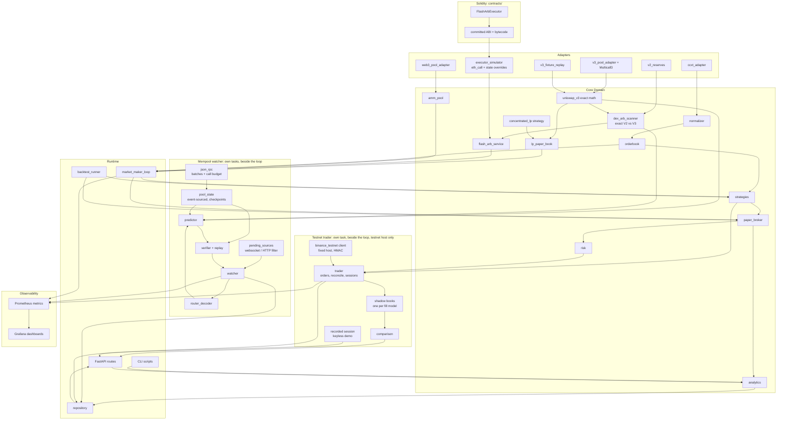

# Architecture

## Overview

crypto-mm-lab is a paper-trading market-making lab that connects to public CEX order books, simulates quote placement and fills, tracks PnL, compares CEX prices against Uniswap V2 and V3 pools, runs a paper Uniswap V3 concentrated-liquidity book alongside the CEX book, simulates its own Solidity flash-arbitrage contract (`contracts/`) against live mainnet state every tick, runs a read-only mempool watcher beside the loop that predicts pending swaps on the two pools and verifies them block by block, and, with free testnet keys, runs the strategy on the Binance spot testnet with real post-only orders to check the paper fill models against a real matching engine.

## Data flow (live loop)

1. **Fetch** — CCXT public order book (+ optional DEX pool via web3).
2. **Apply fills** — paper broker checks if external prices crossed resting quotes.
3. **Strategy** — generate new bid/ask quotes (pure MM, inventory skew, or volatility-adjusted spread).
4. **Risk** — filter quotes that breach position limits and cash-account constraints.
5. **V3 + LP** (when `V3_ENABLED`) — one block-pinned Multicall3 read of the V3 pool; the paper LP book accrues fees from on-chain fee growth, revalues inventory, and rebalances; V3 arbitrage is scanned with exact multi-tick quotes and optimal sizing. A V3 failure never fails the CEX tick.
6. **Flash arb** (when `ARB_SIM_ENABLED`) — V2 reserves are read at the V3 snapshot's block; the exact V2-vs-V3 scanner picks the best trade (or a reference size); the executor's `simulate()` runs against mainnet state at that block in one `eth_call` with state overrides. Nothing is sent. A failure is a labeled skip, never a failed tick.
7. **Persist** — snapshots, fills, positions, PnL, opportunities, V3 snapshot, LP state, rebalances and the flash-arb simulation to SQLite/Postgres in one transaction under the tick's `tick_id`.
8. **Metrics** — expose Prometheus gauges/counters on `/metrics`.

## Mempool watcher (beside the loop)

Started by the app lifespan next to the loop (`MEMPOOL_ENABLED`). It has its own asyncio tasks and its own HTTP client, and it never runs inside a tick.

1. **Intake.** It takes the websocket full-transaction subscription; the HTTP pending filter with batched lookups is the fallback. A dictionary lookup on `to` (or the pool address inside the calldata) rejects ~99% of transactions. Candidates are decoded into legs on our two pools.
2. **Predict.** A bounded queue feeds the predictor. Amounts for multi-hop legs come from one read-only quote of the upstream hops. Each leg is simulated against the latest tracked block, and the 003 scanner runs before and after to flag opportunities.
3. **Blocks.** For each new block the watcher reads the header (transaction order, base fee, parent hash) and the pools' logs by block hash. It rolls state forward, rewinds to a checkpoint on a reorg, and re-anchors on the window edge or every N blocks. Then it resolves watched swaps: included (with error split and back-run check), reverted, replaced (by nonce) or not included. Receipts and nonce checks come out of a per-block call budget.
4. **Replay.** When no pending data is available (or `MEMPOOL_MODE=replay`), every swap in each block is replayed from the block's start state instead.
5. **Persist and metrics.** It writes `mempool_swaps` (upserted as status changes), `mempool_blocks` and `mempool_mode_changes`, and updates the `mm_mempool_*` metrics. A retention sweep runs hourly.

## Testnet trader (beside the loop)

Started by the app lifespan when `TESTNET_ENABLED` is on and both free testnet keys are set (`BINANCE_TESTNET_API_KEY`, `BINANCE_TESTNET_API_SECRET`). It shares only the loop's kill switch and repository. Its REST client can reach `testnet.binance.vision` and nothing else: the host is checked when the client is built and again on every request.

1. **Start.** It syncs the clock with the exchange, reads the trading rules and the account, closes sessions left open by a crashed run, cancels tagged leftover orders, and opens a new session.
2. **Each cycle** (`TESTNET_POLL_INTERVAL_SEC`):
   - It reads the testnet book and the new fills, and lists the open orders. Tagged orders it has no record of are cancelled.
   - The four paper shadows (one per fill model, `calibrated_fill` included) evaluate the orders whose window covers this snapshot.
   - The strategy quotes from the testnet book. Quotes go through the risk limits and are rounded to the trading rules. A side whose price moved more than the threshold is cancelled and replaced with a post-only (`LIMIT_MAKER`) order.
3. **Reconcile** (every `TESTNET_RECONCILE_INTERVAL_SEC`, after any failed request, and on the kill switch). It resyncs the clock, re-reads the balances, resolves orders whose answer was lost, and checks that the session's trade history still exists. A recorded order that no longer exists, or lost history, means the testnet was reset, so the session ends and a new one starts.
4. **Kill switch and stop.** The trader checks the switch every 0.2 s while it waits between cycles. It cancels every tagged order and confirms with the exchange that none remain, showing `cancel_pending` until it can.
5. **Without keys**, no trader runs. The API serves the recorded session in `tests/fixtures/testnet/session.json.gz`, labeled `recorded`. Fill models newer than the recording are replayed from its stored ticks.

## Fill-model calibration (offline)

`scripts/calibrate_fill_model.py` fits `calibrated_fill` from the recorded sessions in `tests/fixtures/testnet/` (specs/006). It needs no keys and no network.

1. **Replay check.** Each recording's ticks are replayed through the shadow books (`app/services/testnet/replay.py`). The replayed fills of the models stored in the recording must equal the stored ones exactly, or the command fails.
2. **Intervals.** Every look a shadow took at an order becomes an interval: from its previous look to the snapshot, with the order's distance from the other side of the book. Crossed looks are left to the deterministic rule. A look counts as a fill when the order's first real fill fell inside it.
3. **Fit.** Maximum likelihood for `chance = 1 − exp(−rate·Δt)`, `rate = touch_rate·exp(−distance/decay)`, by Newton's method (`app/services/testnet/calibration.py`).
4. **Validate.** Leave one session out: fit on the others, predict the held-out session's fills as an expected count and as one replayed draw, next to the other models' counts.
5. **Write.** `app/execution/fill_calibration.json`, committed. `PaperBroker`, the backtest runner, spread sweeps and the testnet shadows read it through `load_fill_calibration`; without it, `calibrated_fill` behaves as `full_cross_fill`. `GET /testnet/calibration` serves it to the dashboard.

## Backtest flow

1. Load historical snapshots from the database or a CSV/Parquet fixture.
2. Replay through the same strategy → fill → PnL pipeline (no network).
3. Output Sharpe ratio, max drawdown, fill rate, and trade log.

## Storage

| Table | Purpose |
|-------|---------|
| `orderbook_snapshots` | Best bid/ask/mid per tick (replay source) |
| `quotes` | Submitted resting quotes |
| `fills` | Simulated fill events |
| `positions` | Inventory snapshots |
| `pnl_snapshots` | PnL time series |
| `opportunities` | DEX–CEX arbitrage signals (V2 and V3, with venue / fee tier / optimal size) |
| `v3_pool_snapshots` | Block-pinned V3 pool state per tick (big integers as decimal strings) |
| `lp_position_states` | Paper LP book state per tick (headline columns + full JSON) |
| `lp_rebalances` | LP open/rebalance events with swap, gas and realized-IL costs |
| `arb_simulations` | Flash-arb simulation per tick: estimate, simulated legs, gas, outcome and its explanation (headline columns + full JSON) |
| `mempool_swaps` | One row per watched or replayed swap, upserted as its status changes: prediction, verification, error split (headline columns + full JSON) |
| `mempool_blocks` | Per block and mode: swaps on our pools, how many were seen pending, back-runs, gap at block end |
| `mempool_mode_changes` | Live/replay switches with time, source and reason |
| `testnet_sessions` | Testnet trader sessions: start and end, end reason (stopped, reset, restart), virtual slice, settings |
| `testnet_orders` | One row per testnet order, upserted through its life cycle (placed, ack, fills, cancel, reject, reconciled) |
| `testnet_fills` | Real testnet fills, unique by exchange trade id |
| `testnet_shadow_fills` | What each paper fill model filled, per order and snapshot |
| `testnet_ticks` | Best bid and ask per testnet snapshot, and the orders the shadows evaluated (for offline recompute) |

SQLite is the default for local dev. Docker Compose uses PostgreSQL via `DATABASE_URL` — the repository abstraction makes the swap config-only.

## Deployment stack

`docker compose up` starts:

- **app** — FastAPI + market maker loop
- **postgres** — persistent storage
- **prometheus** — scrapes `/metrics` every 5s
- **grafana** — pre-provisioned dashboard at port 3000
