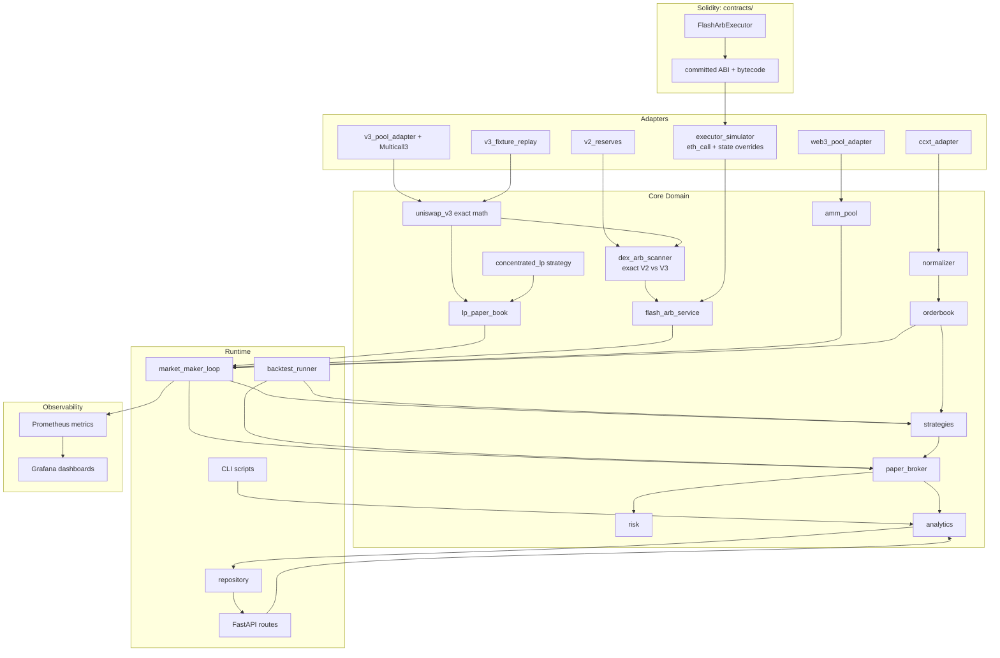

# Architecture

## Overview

crypto-mm-lab is a paper-trading market-making lab that connects to public CEX order books, simulates quote placement and fills, tracks PnL, compares CEX prices against Uniswap V2 and V3 pools, runs a paper Uniswap V3 concentrated-liquidity book alongside the CEX book, and simulates its own Solidity flash-arbitrage contract (`contracts/`) against live mainnet state every tick.

## Data flow (live loop)

1. **Fetch** — CCXT public order book (+ optional DEX pool via web3).
2. **Apply fills** — paper broker checks if external prices crossed resting quotes.
3. **Strategy** — generate new bid/ask quotes (pure MM, inventory skew, or volatility-adjusted spread).
4. **Risk** — filter quotes that breach position limits and cash-account constraints.
5. **V3 + LP** (when `V3_ENABLED`) — one block-pinned Multicall3 read of the V3 pool; the paper LP book accrues fees from on-chain fee growth, revalues inventory, and rebalances; V3 arbitrage is scanned with exact multi-tick quotes and optimal sizing. A V3 failure never fails the CEX tick.
6. **Flash arb** (when `ARB_SIM_ENABLED`) — V2 reserves are read at the V3 snapshot's block; the exact V2-vs-V3 scanner picks the best trade (or a reference size); the executor's `simulate()` runs against mainnet state at that block in one `eth_call` with state overrides. Nothing is sent. A failure is a labeled skip, never a failed tick.
7. **Persist** — snapshots, fills, positions, PnL, opportunities, V3 snapshot, LP state, rebalances and the flash-arb simulation to SQLite/Postgres in one transaction under the tick's `tick_id`.
8. **Metrics** — expose Prometheus gauges/counters on `/metrics`.

## Backtest flow

1. Load historical snapshots from the database or a CSV/Parquet fixture.
2. Replay through the same strategy → fill → PnL pipeline (no network).
3. Output Sharpe ratio, max drawdown, fill rate, and trade log.

## Storage

| Table | Purpose |
|-------|---------|
| `orderbook_snapshots` | Best bid/ask/mid per tick (replay source) |
| `quotes` | Submitted resting quotes |
| `fills` | Simulated fill events |
| `positions` | Inventory snapshots |
| `pnl_snapshots` | PnL time series |
| `opportunities` | DEX–CEX arbitrage signals (V2 and V3, with venue / fee tier / optimal size) |
| `v3_pool_snapshots` | Block-pinned V3 pool state per tick (big integers as decimal strings) |
| `lp_position_states` | Paper LP book state per tick (headline columns + full JSON) |
| `lp_rebalances` | LP open/rebalance events with swap, gas and realized-IL costs |
| `arb_simulations` | Flash-arb simulation per tick: estimate, simulated legs, gas, outcome and its explanation (headline columns + full JSON) |

SQLite is the default for local dev. Docker Compose uses PostgreSQL via `DATABASE_URL` — the repository abstraction makes the swap config-only.

## Deployment stack

`docker compose up` starts:

- **app** — FastAPI + market maker loop
- **postgres** — persistent storage
- **prometheus** — scrapes `/metrics` every 5s
- **grafana** — pre-provisioned dashboard at port 3000
